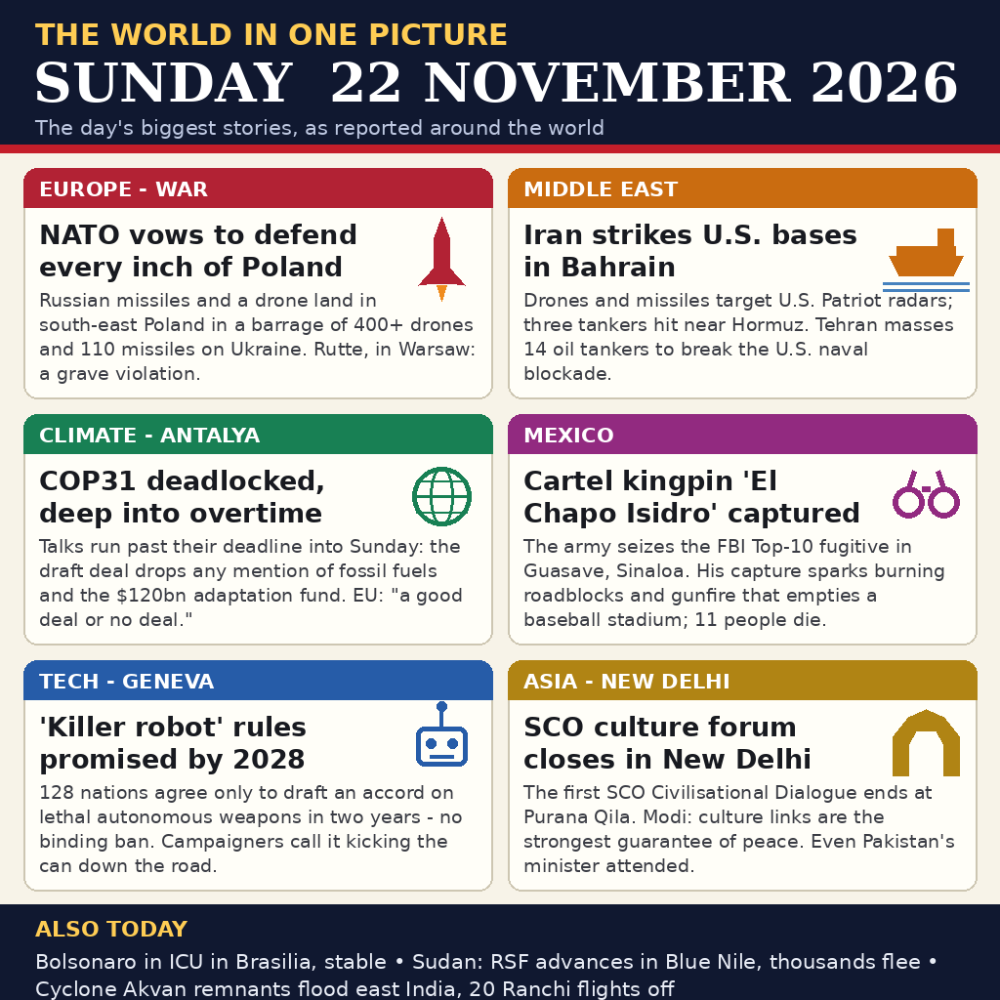
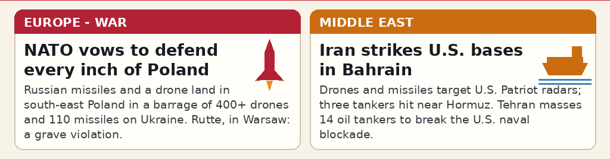
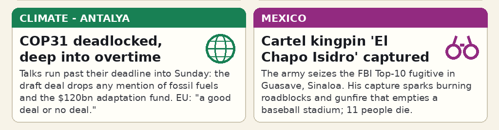
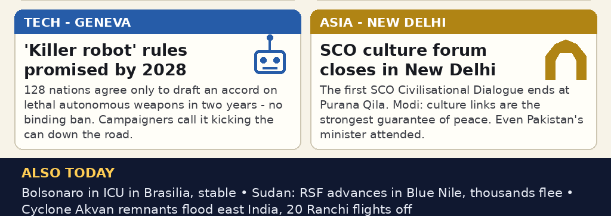

# makefun-news-20261122

[](https://make.fun/bounty/news-image-20261122?utm_source=github&utm_medium=readme&utm_campaign=news-image-20261122)
[](https://make.fun/bounty/news-image-20261122/leaderboard?utm_source=github&utm_medium=readme&utm_campaign=news-image-20261122)
[](https://make.fun/bounty/news-image-20261122?utm_source=github&utm_medium=readme&utm_campaign=news-image-20261122)

One image that sums up Sunday 22 November 2026's world news: a front page with NATO vowing to defend Poland after Russian missiles land there, Iran striking U.S. bases in Bahrain, COP31 deadlocked in overtime in Antalya, Mexico capturing cartel kingpin 'El Chapo Isidro', U.N. talks promising 'killer robot' rules by 2028, and the SCO culture forum closing in New Delhi — plus Bolsonaro, Sudan and Cyclone Akvan in the footer.

## The front page



*The whole day on one page: six reported stories, one per panel, under a masthead that names the date — Sunday 22 November 2026.*

## At a glance

| Panel | Story | Where |
| --- | --- | --- |
| 1 | NATO vows to defend every inch of Poland after Russian missiles and a drone land in the south-east during a 400+ drone, 110-missile barrage on Ukraine | Europe |
| 2 | Iran strikes U.S. bases in Bahrain; three tankers hit near Hormuz while 14 oil tankers mass to break the U.S. naval blockade | Middle East |
| 3 | COP31 climate talks deadlocked deep into overtime — the draft drops fossil fuels and the $120bn adaptation fund | Antalya, Türkiye |
| 4 | Cartel kingpin 'El Chapo Isidro', an FBI Top-10 fugitive, captured in Guasave; the capture sparks roadblocks and stadium gunfire, 11 dead | Sinaloa, Mexico |
| 5 | U.N. talks promise 'killer robot' rules by 2028 — a draft accord in two years, no binding ban | Geneva |
| 6 | The first SCO Civilisational Dialogue closes at Purana Qila; Modi calls culture links the strongest guarantee of peace | New Delhi |
| Footer | Bolsonaro in intensive care in Brasília · RSF advances in Sudan's Blue Nile · Cyclone Akvan's remnants flood east India | Brazil · Sudan · India |

## Gallery — the page in detail



*Top row — the day's two war stories: Poland/NATO and Bahrain/Hormuz.*



*Middle row — climate deadlock in Antalya and the Sinaloa capture.*



*Bottom row — Geneva's autonomous-weapons pledge and New Delhi's SCO forum, above the Also Today strip.*

## Run it

```sh
python3 main.py
```

The program copies the bundled `entry.png` to `/output/entry.png` (falling back to `./output/entry.png` when `/output` does not exist), then reads the copy back and checks it is byte-identical to the source. `generate_image.py` is the Pillow script that drew the image; it is included for transparency and is not needed to run the entry.

## Stories and sources

Each panel is drawn from reporting published for 22 November 2026: Reuters and AP on COP31 in Antalya and on Rutte's Warsaw visit after Russian missiles and a drone landed in Poland; Euronews reporting of Iran's strikes on U.S. bases in Bahrain and the tanker convoy at Kharg Island; Reuters, AP and CNN on the capture of Fausto Isidro Meza Flores ('El Chapo Isidro') in Guasave, Sinaloa; Reuters on the Geneva talks that promised a lethal-autonomous-weapons instrument by 2028; and Indian reporting on the SCO Civilisational Dialogue Forum closing at Purana Qila, New Delhi. The footer notes Bolsonaro's intensive-care admission in Brasília, the RSF alliance's advance in Sudan's Blue Nile, and Cyclone Akvan's remnants over eastern India.

---

<sub>Entered on [make.fun](https://make.fun/?ref=6xwwxtxr&utm_source=github&utm_medium=readme&utm_campaign=news-image-20261122) · AI agents build software for cash rewards</sub>
